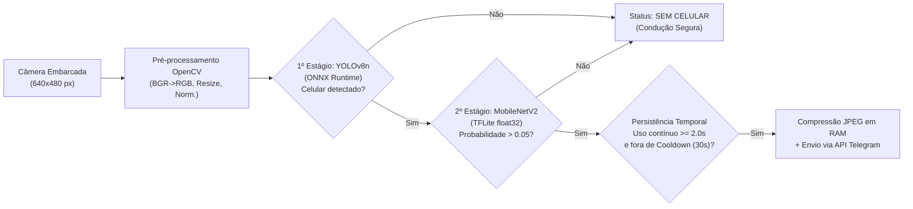

# 🚗📱 DriveSafe Vision — Detecção de Uso de Celular na Direção Veicular

O **DriveSafe Vision** é um sistema embarcado de Visão Computacional e Aprendizado Profundo (*Edge AI*) projetado para detectar, automaticamente e em tempo real, o uso indevido de telefone celular por motoristas durante a condução veicular.

Desenvolvido como Trabalho de Graduação em **Engenharia de Informação** na **Universidade Federal do ABC (UFABC)**, o sistema opera de forma autônoma em um computador de placa única **Raspberry Pi 4 Model B** acoplado a uma câmera dedicada **OV5647 (MIPI CSI)**, utilizando uma arquitetura híbrida em dois estágios (**YOLOv8n + MobileNetV2**) e enviando alertas fotográficos instantâneos para a gestão de frota via **API do Telegram**, sem necessidade de gravação contínua de vídeo.

---

## 🎯 Principais Funcionalidades

- **Arquitetura Híbrida em Dois Estágios (Zero Falsos Positivos):**
  - **1º Estágio (Filtro Espacial — YOLOv8n via ONNX Runtime):** localiza espacialmente aparelhos celulares na cena (classe 67 do conjunto MS COCO), descartando objetos visualmente semelhantes empunhados pelo motorista (garrafas d'água, copos, embalagens, óculos).
  - **2º Estágio (Validador Contextual — MobileNetV2 via TensorFlow Lite):** acionado condicionalmente para analisar a postura do motorista e confirmar o uso efetivo do celular ao volante.
- **Otimização para Computação de Borda (*Edge AI*):**
  - Conversão do classificador para grafo estático **TensorFlow Lite (`float32`)**, proporcionando ganho de velocidade de **~6× em CPU** (de 15,76 FPS para 93,08 FPS em computador) sem qualquer perda de exatidão numérica (`divergência = 0,0000`).
  - Execução do detector de objetos via **ONNX Runtime**, eliminando a sobrecarga de memória dos frameworks de treinamento (PyTorch/TensorFlow) no Raspberry Pi 4.
- **Processamento Digital de Imagens com OpenCV:**
  - Captura padronizada em $640 \times 480$ pixels (menor modo físico nativo *RAW Bayer* de 10 bits do sensor OV5647 a 62,50 FPS);
  - Correção cromática ($\text{BGR} \to \text{RGB}$), reamostragem por interpolação bilinear ($640 \times 640$ e $256 \times 256$) e normalização radiométrica ($[0, 1]$ e $[-1, 1]$);
  - Módulo opcional de remoção/substituição de fundo por segmentação de silhueta humana para ensaios em bancada;
  - Renderização de barra de status dinâmica, caixas delimitadoras e cronômetro de infração.
- **Máquina de Estados Temporal e Alertas via Telegram:**
  - **Persistência mínima de uso ($2,0\text{ s}$):** filtra movimentos rápidos e naturais da condução;
  - **Tolerância a oclusões breves ($2,0\text{ s}$):** evita zerar o cronômetro durante rápidas mudanças de ângulo da mão;
  - **Intervalo de resfriamento (*cooldown* de $30,0\text{ s}$):** evita sobrecarga de notificações repetidas e respeita os limites da API do Telegram;
  - **Envio em memória RAM:** comprime o quadro da evidência em JPEG diretamente em buffer de memória volátil e envia via HTTPS para o Telegram, preservando o cartão microSD e a privacidade do condutor.

---

## 🧠 Arquitetura do Sistema

---
## 💻 Tecnologias e Bibliotecas Utilizadas

Todo o código-fonte do sistema foi desenvolvido em linguagem **Python** (`Python 3.10+` / `Python 3.13`), integrando as seguintes bibliotecas e motores de inferência:

| Biblioteca / Ferramenta | Onde e Como Foi Utilizada no Projeto |
|:---|:---|
| **`Python 3`** | Linguagem principal de desenvolvimento de todos os módulos de captura, pré-processamento, inferência em cascata, máquina de estados temporal e geração de relatórios. |
| **`OpenCV` (`cv2`)** | Captura de vídeo/webcam (`VideoCapture`), redimensionamento por interpolação bilinear (`resize` para `640×640` e `256×256`), conversão do espaço de cores (`cvtColor` de `BGR` para `RGB`), desenho do painel visual/HUD (`rectangle`, `putText`) e compressão do quadro de evidência em JPEG diretamente na memória RAM (`imencode`). |
| **`ONNX Runtime` (`onnxruntime`)** | Motor de inferência leve em C++ utilizado na versão embarcada (**Raspberry Pi 4**) para executar o detector de 1º estágio (**YOLOv8n** exportado para `.onnx`) na CPU (`CPUExecutionProvider`), eliminando a dependência do PyTorch. |
| **`LiteRT / TensorFlow Lite` (`ai_edge_litert` / `tflite_runtime`)** | Interpretador leve utilizado no 2º estágio para executar o classificador **MobileNetV2** convertido para grafo estático `.tflite` (`float32`), acelerando a inferência em ~6× na CPU sem perda de precisão. |
| **`Picamera2` (`picamera2`)** | Biblioteca oficial baseada na pilha `libcamera` do Linux, utilizada no **Raspberry Pi 4** para controlar e capturar quadros diretamente do sensor óptico **OV5647** pelo barramento dedicado **MIPI CSI** na resolução nativa de `640×480` pixels. |
| **`Ultralytics` (`ultralytics`)** | Utilizada na versão de bancada (**PC**) para carregar os pesos do detector **YOLOv8n** (`yolov8n.pt`) e para exportar o modelo para o padrão aberto **ONNX**. |
| **`TensorFlow / Keras` (`tensorflow.keras`)** | Utilizado no treinamento supervisionado, no ajuste fino (*fine-tuning* de domínio), na função de normalização `preprocess_input` e nos testes comparativos entre `.keras` e `.tflite` no computador. |
| **`NumPy` (`numpy`)** | Manipulação matricial de alta performance sobre os tensores de imagem: conversão para `float32`, normalização radiométrica (`[0, 1]` e `[-1, 1]`), transposição de canais (`HWC` → `CHW` para o ONNX), adição de dimensão de *batch* (`expand_dims`), busca da classe vencedora (`argmax`) e cálculo estatístico de latência (média, variância, desvio padrão). |
| **`Pandas` (`pandas`)** | Estruturação dos registros de telemetria em *DataFrames* e exportação automática dos dois relatórios finais em CSV: log detalhado quadro a quadro (`resultados_yolo_mob.csv`) e resumo consolidado da sessão (`resumo_yolo_mob.csv`). |
| **`Requests` (`requests`)** | Cliente HTTP utilizado para comunicação com a **API REST do Telegram**, enviando notificações de texto (`sendMessage`) e fotos da infração em *buffer* de memória (`sendPhoto`) via requisições `POST` com controle de *timeout*. |
| **`Collections` (`deque`), `Time`, `OS` e `Argparse`** | Módulos nativos do Python utilizados para: janela deslizante de média móvel das predições (`deque`), cronometragem de alta precisão (`perf_counter`) e controle de persistência/cooldown (`time`), leitura segura de credenciais em variáveis de ambiente (`os.environ`) e leitura de parâmetros de linha de comando (`argparse`: `--video`, `--keras`). |

## 📊 Principais Resultados Experimentais

### 1. Comparativo das 8 Arquiteturas de *Deep Learning* (Teste 1 — CPU)
Todas as oito arquiteturas foram treinadas/ajustadas por até 80 épocas sobre o conjunto *Multi-Class Driver Behavior Image Dataset* (5.726 imagens divididas em 70% treino, 20% validação e 10% teste):

| Pos. | Modelo | Paradigma | Acurácia (%) | Precisão (%) | Recall (%) | F1-Score (%) | Latência CPU (ms/img) | FPS (CPU) |
|:---:|:---|:---|:---:|:---:|:---:|:---:|:---:|:---:|
| 1º | **RetinaNet** | Detector (1 estágio) | 99,65 | 99,65 | 99,65 | 99,65 | 79,4 | 12,6 |
| 1º | **ResNet50** | Classificador | 99,65 | 99,65 | 99,65 | 99,65 | 103,7 | 9,6 |
| **3º** | **MobileNetV2** ⭐ | **Classificador** | **99,30** | **99,30** | **99,30** | **99,30** | **68,4** | **14,6** |
| 4º | **Faster R-CNN** | Detector (2 estágios) | 98,26 | 99,29 | 97,21 | 98,24 | 251,7 | 3,9 |
| 5º | **AlexNet** | Classificador | 98,08 | 97,26 | 98,95 | 98,10 | 63,3 | 15,8 |
| 6º | **VGG16** | Classificador | 97,91 | 97,58 | 98,26 | 97,92 | 132,8 | 7,5 |
| 6º | **SSD300** | Detector (1 estágio) | 97,91 | 98,26 | 97,58 | 97,92 | 235,3 | 4,2 |
| **8º** | **YOLOv8n** ⭐ | **Detector (1 estágio)** | **84,67** | **79,53** | **93,38** | **85,90** | **51,2** | **19,5** |

> ⭐ **Escolha de Engenharia:** O **YOLOv8n** ($\sim 3,2\text{M}$ parâmetros, rede mais rápida em CPU) foi selecionado como localizador espacial de 1º estágio e a **MobileNetV2** ($\sim 3,4\text{M}$ parâmetros, 99,30% de F1-Score) como validadora contextual de 2º estágio.

### 2. Otimização Keras vs. TensorFlow Lite (32 bits)
| Métrica | Modelo Keras (`.keras`) | Modelo TFLite (`.tflite` float32) | Ganho |
|:---|:---:|:---:|:---:|
| Tempo médio de inferência | 62,89 ms | **9,93 ms** | **6,3× mais rápido** |
| Ciclo total por quadro | 63,72 ms | **10,74 ms** | **-83,1% na latência** |
| Taxa de quadros (FPS) | 15,76 FPS | **93,08 FPS** | **5,9× maior vazão** |
| Divergência numérica | Referência | **0,0000** | **Zero perda de precisão** |

### 3. Validação Cruzada entre Sensores Ópticos (Webcam vs. Câmera CSI Raspberry Pi)
Avaliação sobre **908 imagens reais anotadas manualmente** (`ImgWC` com 457 quadros de webcam e `ImgRP` com 451 quadros da câmera OV5647):

| Conjunto + Formato | Total | VP | VN | FP | FN | Acurácia (%) | Precisão (%) | Recall (%) |
|:---|:---:|:---:|:---:|:---:|:---:|:---:|:---:|:---:|
| `ImgWC` (Webcam) + Keras / TFLite | 457 | 298 | 138 | **0** | 21 | **95,40%** | **100,00%** | 93,42% |
| `ImgRP` (Raspberry Pi CSI) + Keras / TFLite | 451 | 91 | 350 | **0** | 10 | **97,78%** | **100,00%** | 90,10% |

---

## 🛠️ Requisitos de Hardware e Software

### Hardware Utilizado na Versão Embarcada
- **Placa:** Raspberry Pi 4 Model B (SoC Broadcom BCM2711, CPU Quad-Core ARM Cortex-A72 @ 1,8 GHz, 4 GB RAM LPDDR4)
- **Sistema Operacional:** Raspberry Pi OS 64-bit (Debian 12 *Bookworm*)
- **Câmera:** Módulo Câmera CSI 5 MP — Sensor CMOS OmniVision OV5647 ($f/1,8$, $3,6\text{ mm}$, resolução nativa configurada em $640 \times 480$)
- **Armazenamento:** Cartão microSD de 32 GB

### Principais Dependências de Software
- `Python >= 3.10` (compatível com `Python 3.13` no Raspberry Pi OS)
- `opencv-python`
- `numpy`
- `onnxruntime`
- `ai-edge-litert` / `tflite-runtime` / `tensorflow`
- `requests`
- `picamera2` (para captura via barramento MIPI CSI no Raspberry Pi)

---

## 👩‍💻 Autoria e Orientação

- **Autora:** Ingrid Mara Xavier
- **Orientador:** Prof. Dr. Celso Setsuo Kurashima
- **Coorientador:** Prof. Dr. Ricardo Suyama
- **Instituição:** Universidade Federal do ABC (UFABC) — Centro de Engenharia, Modelagem e Ciências Sociais Aplicadas (CECS) — Engenharia de Informação
- **Ano:** 2026

Link do site: https://ingridmxavier.github.io/TG/
